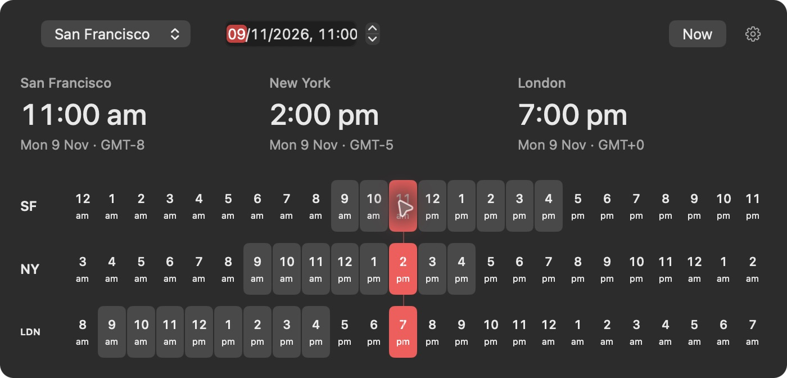

# World Clocks

A native macOS menu bar clock with a visual planner for calls across time zones.

Pick 11 am in San Francisco and see the same moment in New York and London. Drag across the timeline or scroll horizontally to find another time. Every city updates together.



## What it does

- Shows live clocks in the menu bar. SF and NY are visible by default.
- Opens aligned timelines for San Francisco, New York, and London.
- Scrubs to the minute with dragging or horizontal scrolling, including trackpad momentum.
- Converts dates with each city's daylight-saving rules. Shaded cells mark 9 am to 5 pm.
- Supports up to six cities, editable short labels, and a choice of which clocks appear in the menu bar.
- Saves settings locally. No account, network requests, or external dependencies.

The interface uses AppKit and SwiftUI, follows the system appearance, and respects Reduce Motion.

## Download and install

[Download the latest release](https://github.com/lukeramsden/world-clocks/releases/latest).

1. Download the **universal DMG**. It works on Apple Silicon and Intel Macs running macOS 14 or later.
2. Open the DMG and drag **World Clocks** into **Applications**.
3. Launch it from Applications. The clock appears in the menu bar.

The current release is ad-hoc signed and not notarized by Apple. If macOS blocks the first launch, open **System Settings → Privacy & Security** and choose **Open Anyway** after trying to launch the app. No developer tools are needed to use the download.

For updates, quit World Clocks from its right-click menu, then replace the app in Applications. Settings are kept. Updates are manual.

## Build from source

Requires macOS 14 or later and the Xcode Command Line Tools. If you need the tools, install them with `xcode-select --install`.

```sh
git clone https://github.com/lukeramsden/world-clocks.git
cd world-clocks
make build
```

The app is built at `.build/World Clocks.app`. Open it in Finder to run it, or install it in Applications:

```sh
make install
```

Then launch **World Clocks** from Applications. It runs in the menu bar without a Dock icon. Quit an existing copy before installing an update.

The build uses your Mac's architecture and a local ad-hoc signature. It is not a notarized distribution build. macOS 14 is the deployment target; development and testing were done on macOS 26.

## Use

Click the menu bar clock to open the planner. Choose a reference city and enter a date and time, click an hour, or drag across any timeline. Horizontal scrolling over the timeline changes the selected time too. All rows show the same instant, including when a city is on a different date.

**Now** returns to the current time. Click outside the planner or press Escape to dismiss it.

The cog opens a separate settings window. Add or remove cities, search time zones, change labels, and toggle menu bar visibility. Changes save automatically; **Restore defaults** brings back SF, NY, and LDN. If you hide every menu bar clock, a clock icon remains so you can still open the planner.

Right-click or Control-click the menu bar clock to quit. To start automatically, add the installed app to your macOS login items.

## Development

```sh
make test
```

The checks cover time-zone conversion, the weeks when US and UK daylight-saving dates differ, 23- and 25-hour days, minute-level drag positions, horizontal scroll events, and settings persistence. Tests use a separate preferences domain.

Source files are in `Sources/WorldClocks`: `AppDelegate.swift` owns the menu bar and windows, `Planner.swift` lays out the planner, `Timeline.swift` handles scrubbing, and the settings files manage configuration and its interface. `Clock.swift` handles date formatting and the day's timeline.

## Releases

`make release` runs the checks, builds a universal app, and creates a DMG, ZIP, and SHA-256 checksums in `dist/`.

To publish a version:

1. Update `CFBundleShortVersionString` and increment `CFBundleVersion` in `Info.plist`.
2. Commit and push the change to `master`.
3. Tag the commit and push it, for example:

   ```sh
   git tag v1.0.1
   git push origin v1.0.1
   ```

The Release workflow checks that the tag matches the app version, runs the tests, builds both architectures, and publishes the downloads to GitHub Releases. A failed check prevents publication.

### Apple signing and notarization

Without Apple credentials, releases use an ad-hoc signature and clearly say that they are not notarized. For a standard first-launch experience, add these GitHub Actions repository secrets:

| Secret | Value |
| --- | --- |
| `APPLE_CERTIFICATE_P12` | Base64-encoded Developer ID Application certificate and private key, exported as a `.p12` file |
| `APPLE_CERTIFICATE_PASSWORD` | Password for the `.p12` file |
| `APPLE_SIGNING_IDENTITY` | Full `Developer ID Application: ...` identity |
| `APPLE_ID` | Apple Developer account email |
| `APPLE_TEAM_ID` | Developer team ID |
| `APPLE_APP_PASSWORD` | App-specific password for notarization |

When the certificate is present, the workflow requires all signing credentials, signs with the hardened runtime, submits the DMG to Apple, and staples the notarization ticket. A signing or notarization failure stops the release. Credentials stay in Actions secrets; the temporary keychain is removed after the job.

For local signed packaging, set `SIGNING_IDENTITY` and `NOTARY_PROFILE` before running `make release`. The latter names an existing `notarytool` keychain profile. See [Apple's notarization documentation](https://developer.apple.com/documentation/security/notarizing-macos-software-before-distribution).
